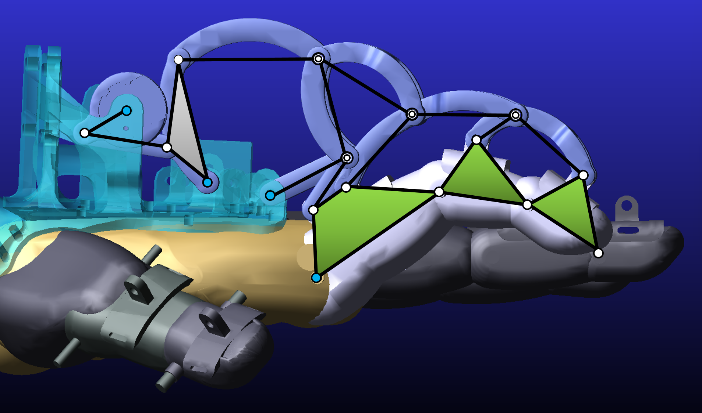
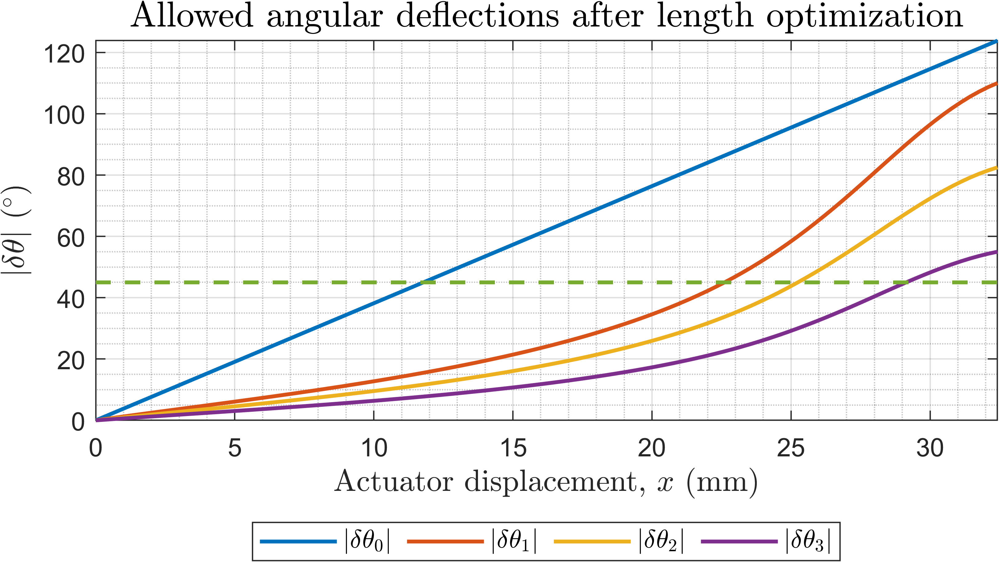
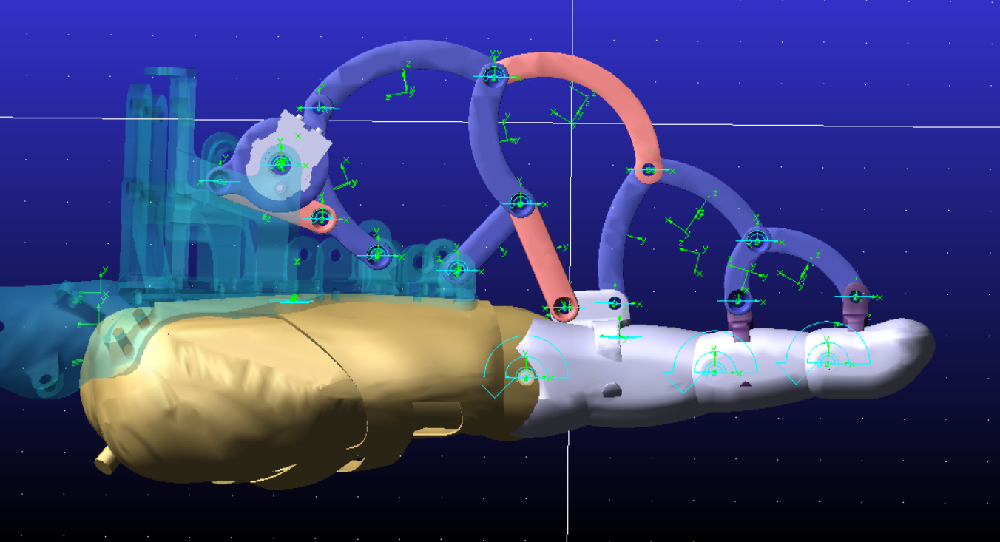
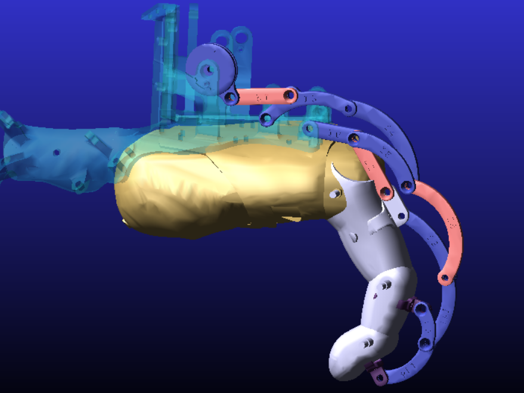

# Hand exoskeleton kinematics

MATLAB and Python analysis of a five-digit, six-actuator, linkage-driven hand exoskeleton for master-slave grasping and force feedback. The work was done as a B.Tech. project at NIT Durgapur with CSIR-CMERI, February–May 2022.

Each non-thumb finger is a planar closed chain of 16 links and 3 mechanism degrees of freedom, driven by one actuator. The thumb uses two actuators. Forward kinematics use circle-circle intersection for the fingers and circle-sphere intersection for the thumb. Link lengths were adjusted so the modeled MCP flexion reaches 110° without the singularity that stopped the original linkage. Inverse kinematics for the four fingers come from monotonic actuator-to-pose curves. The thumb inverse map is a 500 by 500 numerical table.

Advisors: Prof. Shibendu Shekhar Roy (NIT Durgapur) and Dr. Abhijit Mahapatra (CSIR-CMERI).

The written thesis is on Zenodo: [doi:10.5281/zenodo.22812016](https://doi.org/10.5281/zenodo.22812016). The file on that record is the signed thesis, with redactions on the front matter.

Frontal SolidWorks render of the assembly. The thumb mechanism is on the right. The finger linkages sit on the dorsal shell.

Dorsal render of the same assembly. The arched links over the fingers are the four planar mechanisms.

Close-up of one finger linkage on the dorsal shell.

## Linkage

Kinematic diagram of one finger. The labels match the loop-closure scripts in `kinematics/`.

Skeleton of the index-finger linkage drawn on the CAD model, viewed normal to the sagittal plane. This is Fig. 5 of the thesis.

Index finger from the forward-kinematics study, at the start of travel and at the end. The dotted curve is the fingertip path.

Open pose and closed pose from `kinematics/linkage_kinematics.m`, with the fingertip path. In that script the finger command runs from 0° to −107°.

## Range

Index-finger joint travel against actuator displacement, before and after the link-length change recorded in `data/length_optimization.xlsx`. After the change, MCP flexion passes 110°. The circular-grasp target in the thesis is a PIP deflection of |δθ₂| = 45°, which the index finger reaches near 26.3 mm of actuator travel.

Joint angles over 100 steps of the index-finger simulation.

Joint angles θ₀, θ₁, θ₂, and θ₃ for the index, middle, and little fingers, from the results sheets in `data/linkage_model_data.xlsx`. The dashed line is 45°. These curves are the joint angles stored in the workbook. The thesis plots the absolute deflections |δθ₀| through |δθ₃|, and its circular-grasp target is |δθ₂| = 45°. The workbook has no ring-finger results sheet.

Ring-finger deflections after the length change. This is the project figure used as Fig. 17 of the thesis. The dashed line is 45°. The thesis gives the actuator displacement for |δθ₂| = 45° on this finger as 25.2 mm.

## Full hand

All five digits from `hand/hand_simulation.mlx`, open and closed.

Schematic of the thumb linkage. The front view is the flexion–extension chain, and the top view is the abduction–adduction chain. This is Fig. 27 of the thesis. The labels match the thumb scripts in `fingers/thumb/`.

Thumb linkage and the fingertip workspace from the thumb forward-kinematics study.

Thumb inverse map θ₁(θ₀, θ₀\*), drawn from `data/theta1-inverse-mapping-500x500.xlsx`. The axes are the query ranges in `fingers/thumb/thumb_analysis.m`.

## Two-link dynamics

Angular position of the planar two-link model in `dynamics/`.

## Results carried in this repository

- For the four fingers, range extension targets an MCP angle θ₁,f = −110°. A circular grasp also asks for a PIP deflection |δθ₂| = 45°.
- At that grasp pose, Table 10 of the thesis lists actuator displacements of 2.63 cm, 2.3 cm, 2.52 cm, and 2.76 cm for the index, middle, ring, and little fingers (about 26.3 mm, 23.0 mm, 25.2 mm, and 27.6 mm). The pulley travel |δθ₀| at the same pose is 100.32°, 87.81°, 96.42°, and 105.44°. Those pulley angles sit above the 76.39° limit that a 15 mm actuator would allow. An actuator of about 30 mm can reach |δθ₂| = 45°.
- Thumb range extension targets θ₁ from 0° to 50°, and that range is reached by step 10. The two thumb actuators are limited to x ≤ 23.98 mm and x\* ≤ 22.67 mm. The design displacement for the full range of both is 25 mm.
- Thesis Fig. 24 compares the index-finger pulley angle from MATLAB with an Adams run over 0–10 s, and describes the difference as minor. The spreadsheet plot below is a separate four-finger record.
- The Adams model shows a collision between the linkage and the finger near 60° of index MCP deflection (thesis Fig. 25).

Index finger after the link lengths were changed in the CAD model. The modified links are red. This is Fig. 23 of the thesis.

Flexed pose used for Fig. 25 of the thesis. The thesis reports that a collision between the links and the finger segments first appears near 60° of MCP deflection. The lengthened links are red.

Finger angle change from `data/adams-vs-matlab.xlsx`. The largest absolute difference on this record is 6.6° for the index, 5.3° for the middle, 0.7° for the ring, and 19.2° for the little finger. Thesis Fig. 24 is the separate 0–10 s index-pulley comparison.

## Layout

| Path | Contents |
| --- | --- |
| `kinematics/` | Finger loop-closure position and inverse-kinematics scripts |
| `dynamics/` | Symbolic two-link planar dynamics in MATLAB and Python, plus a short animation |
| `fingers/` | Per-digit forward-kinematics live scripts and the thumb analysis |
| `hand/` | Full-hand simulation driven by six actuator inputs |
| `data/` | Link-length optimization, Adams comparison, and the thumb inverse-mapping tables |
| `geometry/` | FreeCAD sketches of the four fingers and the linkage model |
| `results/` | Adams result channels for the hand (`hand.res` and the accompanying request files) |

`fingers/thumb/thumb_analysis.m` and `thumb_simulation.m` read the spreadsheets in `data/`.

The scripts were written for MATLAB with the Symbolic Math Toolbox, and for Python with SymPy, NumPy, and Matplotlib. The `.mlx` files are MATLAB live scripts.

## Models

Adams binaries and CAD solids are attached to the `models-v1` release. They are not in the git history. Clone this repository for the code, then download the release assets below.

| Release asset | What it is |
| --- | --- |
| `adams-verification-model1.bin` | Adams model compared with `data/adams-vs-matlab.xlsx` |
| `adams-hand-v3.bin` | Later Adams model of the hand |
| `adams-index-finger.bin` | Index-finger Adams model used for the kinematic check |
| `hand-v8-adams.stp` | STEP of the verified assembly |
| `hand-model.stp` | Full solid export of the hand |
| `hand-model-v3.SLDASM` | SolidWorks assembly |
| `thumb-model.FCStd` | Thumb model in FreeCAD |

## License

MIT. See [LICENSE](LICENSE).
