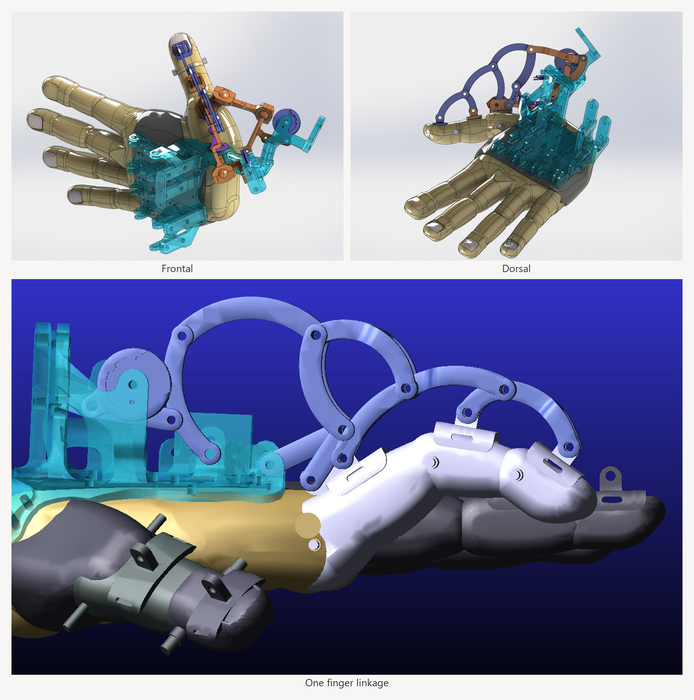
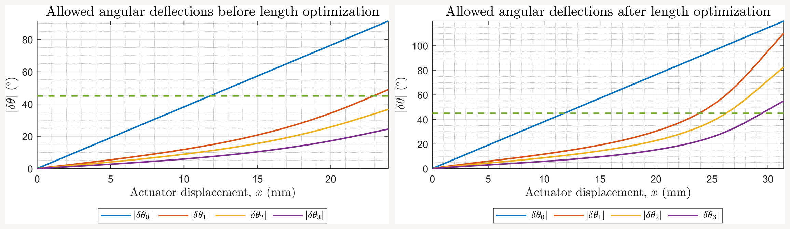
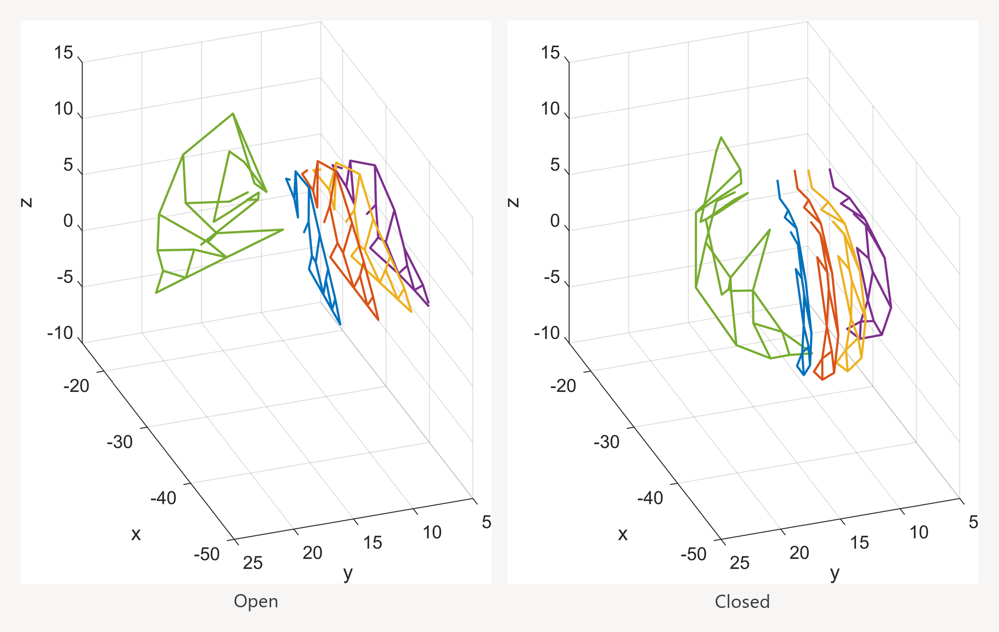

# Underactuated hand exoskeleton

Kinematic analysis and motion-range optimization of a five-digit, six-actuator hand exoskeleton for master–slave robotic grasping and force feedback. Its underactuated linkages couple multiple finger joints to a single actuator, making the mechanism’s geometry central to the grasping motion it can achieve.

Completed by Nilabro Saha as a B.Tech. thesis at NIT Durgapur and a project internship at CSIR-CMERI, February–May 2022.

## Project highlights

- **Kinematic modeling:** developed MATLAB forward and inverse models for the 16-link finger mechanisms and the thumb.
- **Range optimization:** adjusted link lengths to avoid the singularity limiting the original finger mechanism, extending modeled knuckle flexion to approximately 110°.
- **Actuator-to-pose mapping:** related actuator travel to finger poses and combined all five digits in a full-hand simulation with four finger inputs and two thumb inputs.
- **Multibody verification:** checked modeled motion in MSC Adams and identified mechanical interference that limits the assembly’s usable range.

## Selected results

The linkage-driven assembly couples finger motion mechanically, with one actuator for each non-thumb finger and two for the thumb’s flexion and sideways motion.

Before and after the link-length changes: the modeled metacarpophalangeal (MCP), or knuckle, range increases. Adams also revealed linkage–finger interference near 60° of index MCP flexion, so the modeled 110° range does not establish collision-free travel for the assembly.

Open and closed full-hand poses. The kinematic studies reached the grasping targets of 45° flexion at the proximal interphalangeal (PIP), or middle, joints of the four fingers and 50° thumb flexion.

## Explore the project

- [Read the thesis: *Analysis of an Underactuated Linkage-driven Hand Exoskeleton for Master-Slave Force Feedback System*](https://doi.org/10.5281/zenodo.22812016) for the methodology and detailed findings.
- Browse the [finger kinematics](kinematics/), [per-digit studies](fingers/), and [full-hand simulation](hand/).
- [Download CAD and Adams models](https://github.com/nilabro-saha/hand-exoskeleton/releases/tag/models-v1) from the project release.

The analysis uses MATLAB, including live scripts and the Symbolic Math Toolbox, with supporting Python work using SymPy, NumPy, and Matplotlib. CAD and simulation assets span SolidWorks, FreeCAD, and Adams.

## Acknowledgments and license

Advised by Prof. Shibendu Shekhar Roy (NIT Durgapur) and Dr. Abhijit Mahapatra (CSIR-CMERI).

Released under the [MIT License](LICENSE).
